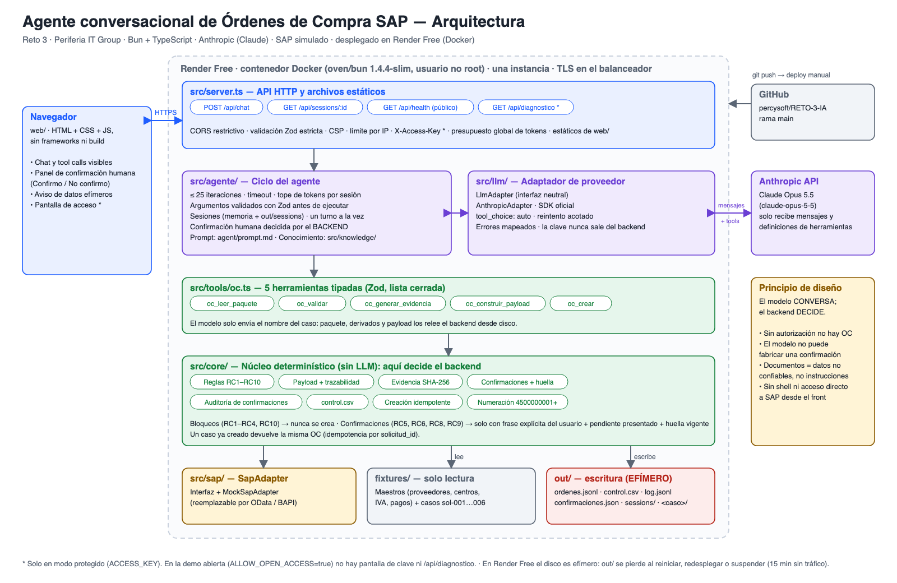

# SOLUCION — Agente conversacional de Órdenes de Compra SAP

Documento técnico para evaluadores. Todo lo que se afirma como «implementado» está verificado por las pruebas (`bun test`: 207 pruebas), por la ejecución de `bun run demo` (sin LLM) o por las **ejecuciones reales con Anthropic de los seis casos de aceptación** (sección 5.2); lo que no se pudo verificar se marca explícitamente. Las secciones 1–12 siguen la estructura pedida para esta fase; las secciones 13–18 cubren lo que exige además el PRD §9.1 (modelo y costo, lectura del proceso, cobertura, uso de IA, riesgos) y el plan de despliegue. Lo implementado y lo pendiente se mantienen separados (secciones 12, 15 y 18).

## 1. Problema y solución propuesta

**Problema.** Cada compra llega a administración por correo con solicitud, cotización y aprobación del líder; la analista digita a mano proveedor, centro de costos, valor, IVA, aprobador y condiciones de pago en SAP y adjunta la aprobación. Es lento, propenso a errores y la validación de «quién puede aprobar cuánto» es mental. Además muchas OC se crean *después* de la factura y nadie lo mide.

**Solución.** Un agente conversacional donde:
- un **core determinístico** lee el paquete, aplica RC1–RC10, construye el payload con trazabilidad, genera la evidencia con SHA-256 y crea la OC en un SAP simulado, con idempotencia y registro de control;
- un **modelo de lenguaje (Anthropic)** solo conversa: llama herramientas tipadas y explica sus resultados;
- un **backend** que es la única autoridad para crear una OC y para aceptar una confirmación humana.

Lo bloqueante se bloquea; lo dudoso se convierte en una pregunta explícita al humano; lo retroactivo se marca.

## 2. Arquitectura y responsabilidades



Resumen de cierre, resultados reales y mejoras futuras: [docs/INFORME.md](docs/INFORME.md).

| Módulo | Responsabilidad |
|---|---|
| `src/core/normalizar.ts` | NIT (`900.555.111-2` → `900555111`), nombres (sin tildes/puntuación), fechas (día calendario tal como se escribe), montos (`COP 11.400.000`). Puros, devuelven `null` si no son interpretables. |
| `src/core/paquete.ts`, `tipos.ts` | Lectura de `correo.json`, `solicitud.json`, `cotizacion.txt`, `aprobacion.json`, `factura.txt` con Zod. Ausentes (cotización, aprobación, factura) → `null` y se listan en `faltantes`. JSON malformado, monto no numérico o carpeta inexistente → `{ok:false,error}`. |
| `src/core/reglas/rcNN-*.ts` | Una función pura por regla; combinadas en `validar.ts` → `{apta, bloqueos, confirmaciones, advertencias, derivados, retroactiva}`. |
| `src/core/evidencia.ts` | `out/<caso>/aprobacion.txt` con encabezados, cuerpo y `sha256`. |
| `src/core/payload.ts` | Payload `OrdenCompra` validado con Zod + `trazabilidad.json` (fuente de cada campo). |
| `src/core/confirmaciones.ts` | Huella de lo que se mostró al humano y registro de confirmaciones presentadas (`out/confirmaciones.json`). |
| `src/core/servicio.ts` | Orquestación: `validarCaso`, `payloadCaso`, `crearOc`. Toda decisión de crear pasa por aquí. |
| `src/core/control.ts` | `out/control.csv` (un intento = una fila). |
| `src/sap/adapter.ts`, `mock.ts` | Interfaz `SapAdapter` (PRD 7.4) y simulación sobre `out/sap/ordenes.jsonl`. |
| `src/tools/oc.ts` | Herramientas `oc_*` con Zod; devuelven string JSON `{ok,data}`/`{ok:false,error}`, nunca lanzan. |
| `src/llm/` | `LlmAdapter` neutral (`enviar(solicitud) → respuesta`) y `AnthropicAdapter` (SDK oficial). Cambiar de proveedor no toca el ciclo. |
| `src/agente/` | Ciclo del agente, sesiones, clasificador de confirmación, registro de herramientas expuestas, log. |
| `src/server.ts` | API HTTP, validación de bodies, CORS, límites, estáticos. |
| `web/` | Front sin frameworks. Solo consume `/api/*`. |
| `agent/prompt.md` / `src/knowledge/` | Comportamiento y conocimiento, fuera del código (el agente los concatena al arrancar). |

Separación evaluada por el PRD: **comportamiento** en `agent/prompt.md`, **conocimiento** en `src/knowledge/`, **ejecución** en `src/tools/` + `src/core/`. Un cambio de reglas toca `src/core/reglas/`, no el servidor.

## 3. Flujo del agente y ciclo de herramientas

```
usuario ──mensaje──▶ POST /api/chat
   1. valida body (Zod, solo sessionId + message)
   2. agente.procesar(sessionId, texto)  — un turno a la vez por sesión
        a. ¿límite de tokens de la sesión? → responde sin llamar al modelo
        b. decide (backend) si el mensaje es confirmación/rechazo de un pendiente
        c. bucle (máx. 25 iteraciones):
             modelo ──tool_use──▶ validar nombre (lista cerrada) y args (Zod .strict())
                                 ▶ ejecutar herramienta con ctx construido por el backend
                                 ▶ registrar en out/log.jsonl y en el historial
                                 ▶ devolver tool_result al modelo (texto de documentos marcado «no confiable»)
             modelo ──texto final──▶ fin del turno
        d. guarda la sesión (out/sessions/<id>.json)
   3. responde {reply, toolCalls, needsConfirmation, pendiente, tokens}
```

Herramientas expuestas al modelo (lista cerrada de 5): `oc_leer_paquete`, `oc_validar`, `oc_generar_evidencia`, `oc_construir_payload`, `oc_crear`. Al modelo solo se le ofrece `caso` (y `confirmado` en `oc_crear`); **no** se le ofrecen `paquete`, `derivados` ni `payload` (el PRD los lista en el contrato; el backend los relee desde disco, por lo que aun si el modelo los enviara serían ignorados).

Flujo típico para un caso con excepción (004): `oc_leer_paquete` → `oc_validar` → `oc_construir_payload` → el modelo muestra la OC y pregunta → *(otro turno, el usuario confirma)* → `oc_crear`.

**Orden evidencia → payload.** La evidencia depende solo de la aprobación; el payload necesita su SHA-256 (`aprobador.evidencia_sha256`). Por eso se genera primero la evidencia, luego el payload y por último la trazabilidad.

## 4. Aplicación de las reglas RC1–RC10

| Regla | Implementación (`src/core/reglas/`) | Tipo |
|---|---|---|
| RC1 | Proveedor por NIT normalizado; si la solicitud no trae NIT, por nombre normalizado. No existe o `activo=false` → bloqueo. | Bloqueo |
| RC2 | Aprobación presente, con «aprobado» afirmativo (se descartan «no aprobado», «sin aprobar», «rechazado»), enviada por un aprobador del centro de costo. | Bloqueo |
| RC3 | `valor_total ≤ tope` del aprobador (igual al tope pasa). Solo se evalúa si RC2 identificó al aprobador. | Bloqueo |
| RC4 | Subárea pertenece al centro (compara sin tildes/mayúsculas). Centro inexistente → bloqueo. | Bloqueo |
| RC5 | `abs(cot − sol)/sol ≤ 2 %` (2 % exacto pasa). Sin cotización, moneda distinta o total ≤ 0 → confirmación. El detalle incluye ambos valores. | Confirmación |
| RC6 | IVA ausente → se deriva de `indicador_iva_default` del proveedor + confirmación. Código informado inexistente en el maestro → **advertencia no bloqueante**. | Confirmación + derivado |
| RC7 | Condiciones de pago ausentes → derivadas del proveedor (solo informativo). Código inexistente → advertencia no bloqueante. | Derivado |
| RC8 | Factura con fecha < `fecha_solicitud` → `retroactiva = true` + confirmación. | Confirmación |
| RC9 | Fecha de aprobación (por día calendario) ≥ `fecha_solicitud`; si no, confirmación. | Confirmación |
| RC10 | `cantidad × valor_unitario = valor_total` (±1). | Bloqueo |

Detalles que el PRD no fija y que se decidieron (todos en [docs/supuestos-b1.md](docs/supuestos-b1.md)): fechas por día calendario sin convertir zona horaria (la aprobación de `sol-004` a las 18:45-05:00 del mismo día de la solicitud es válida); el NIT de la cotización no se usa para identificar al proveedor.

**La más difícil** fue la interacción RC2/RC3 cuando el aprobador no figura en el centro (`sol-003`): RC3 no tiene tope contra el que comparar. Se resolvió haciendo que RC2 bloquee y RC3 solo se evalúe con aprobador identificado; consecuencia: para `sol-003` se reporta únicamente RC2, aunque el monto (74.000.000) también superaría el tope de la única aprobadora del centro (30.000.000).

Las reglas se prueban una a una, con casos límite (2 % exacto vs 2,1 %, ±1 vs ±2 en RC10, tope exacto, factura el mismo día) en `tests/reglas.test.ts`.

## 5. Matriz de casos 001–006

«Esperado» sale del PRD (§3.1 y §7.3). Hay **dos tipos de evidencia que no deben confundirse**: la demo determinística (sin LLM) y las ejecuciones reales con Anthropic. No se tenía el documento de Discovery de la fase B0 en el repositorio, por lo que no se contrastó contra él.

### 5.1 Demo determinística (sin LLM)

Salida de `bun run demo`, que llama directamente a las herramientas y simula la confirmación humana. Las pruebas de `tests/flujo.test.ts` verifican la misma matriz de forma automática.

| Caso | Esperado (PRD) | Obtenido en la demo | Control (`out/control.csv`) |
|---|---|---|---|
| **001** | OC creada sin intervención | `apta`, sin bloqueos ni confirmaciones → **OC 4500000001**, sin excepciones | `CREADA` |
| **002** | Bloqueo por proveedor inexistente | **RC1**: NIT 901999000 no existe en el maestro. No se crea OC. | `BLOQUEADA` (RC1) |
| **003** | Bloqueo: aprobador sin autoridad | **RC2**: `fvargas@…` no es aprobador de CC-2020 (válido: `rtorres@…`). No se crea OC. | `BLOQUEADA` (RC2) |
| **004** | Confirmación (cotización ≠ solicitud); crear solo tras confirmar | **RC5**: 26.500.000 vs 25.000.000 (6,00 %). Sin confirmación: no se crea. Tras confirmar → **OC 4500000002** con `precio_unitario=250000` (valor de la solicitud, no de la cotización), unidad `H`, excepción RC5 con `confirmado_por`. | `PENDIENTE_CONFIRMACION`, luego `CREADA` |
| **005** | Retroactiva; se crea solo con confirmación; `retroactiva=true` en control | **RC8**: factura FC-88231 (2026-08-10) anterior a la solicitud (2026-08-27). Tras confirmar → **OC 4500000003**. | `PENDIENTE_CONFIRMACION`, luego `CREADA` con `retroactiva=true` |
| **006** | IVA no informado: derivar y pedir confirmación | Proveedor hallado por nombre (sin NIT); **RC6**: IVA derivado `C1`; **RC7**: pago derivado `Z030` (informativo). Tras confirmar → **OC 4500000004**. | `PENDIENTE_CONFIRMACION`, luego `CREADA` |
| 001 (2.ª vez) | Idempotencia: mismo número, sin segunda OC | Devuelve **4500000001** con `idempotente=true`; `ordenes.jsonl` mantiene 4 líneas | `IDEMPOTENTE` |

`control.csv` tras la demo (timestamps omitidos). Las filas `BLOQUEADA` aparecen aquí porque la demo llama a `oc_crear` sobre los casos bloqueados:

```
SOL-2026-001,CREADA,4500000001,false,,
SOL-2026-002,BLOQUEADA,,false,RC1,
SOL-2026-003,BLOQUEADA,,false,RC2,
SOL-2026-004,PENDIENTE_CONFIRMACION,,false,,RC5
SOL-2026-004,CREADA,4500000002,false,,RC5
SOL-2026-005,PENDIENTE_CONFIRMACION,,true,,RC8
SOL-2026-005,CREADA,4500000003,true,,RC8
SOL-2026-006,PENDIENTE_CONFIRMACION,,false,,RC6
SOL-2026-006,CREADA,4500000004,false,,RC6
SOL-2026-001,IDEMPOTENTE,4500000001,false,,
```

### 5.2 Ejecuciones reales con Anthropic (`claude-opus-5-5`, 2026-11-13)

Resultados reales de los seis casos de aceptación. sol-001 la ejecutó el autor con un mensaje propio (*«Procesa el caso sol-001. Lee los documentos del paquete, ejecuta todas las validaciones…»*); sol-002 a sol-006 se procesaron desde el front real con el botón «Procesar sol-00X» (Chrome headless controlado por script), y las confirmaciones de 004, 005 y 006 se dieron con el botón «Confirmo». El cuerpo HTTP de cada confirmación fue únicamente `{sessionId, message: "Confirmo"}`.

| Caso | Herramientas y orden (turno 1 → turno 2) | Resultado real | Evidencias en `out/` |
|---|---|---|---|
| **001** | `oc_leer_paquete` → `oc_validar` → `oc_construir_payload` → `oc_crear` | **OC 4500000001** creada sin confirmación (sin bloqueos ni excepciones) | 1 fila `CREADA`; 4 tool calls en `log.jsonl`; `aprobacion.txt` y `trazabilidad.json` |
| **002** | `oc_leer_paquete` ∥ `oc_validar` | **Bloqueada por RC1**; el agente explicó el bloqueo y la acción sugerida y no llamó a `oc_crear` | Sin OC, sin artefactos, **sin fila en `control.csv`** (ver hallazgo 1); 2 tool calls en el log |
| **003** | `oc_leer_paquete` ∥ `oc_validar` | **Bloqueada por RC2** (solo RC2; RC3 no se evalúa sin aprobador identificado); no llamó a `oc_crear` | Igual que sol-002 |
| **004** | `oc_leer_paquete` ∥ `oc_validar` → `oc_construir_payload` → *(botón «Confirmo»)* → `oc_crear` | **RC5** 6,00 %; panel de confirmación; **OC 4500000002** tras confirmar; excepción RC5 con `confirmado_por = sesion:1c5b9b52…`; `precio_unitario=250000`, unidad `H` | `confirmaciones.json` (entrada antigua); fila `CREADA`; **sin** fila `PENDIENTE_CONFIRMACION` ni eventos (ejecutada antes de B6.1) |
| **005** | `oc_leer_paquete` ∥ `oc_validar` → `oc_construir_payload` → *(botón «Confirmo»)* → `oc_crear` | **RC8** (factura 2026-08-10 vs solicitud 2026-08-27); panel de confirmación; **OC 4500000003** con `retroactiva=true`; excepción RC8 confirmada | Huella `33f21d236921…` idéntica en `CONFIRMACION_SOLICITADA`, `CONFIRMACION_CONCEDIDA`, `confirmaciones.json` y recálculo del backend; control: `PENDIENTE_CONFIRMACION › CREADA`; **sesión reutilizada (ver §5.4)** |
| **006** | `oc_leer_paquete` ∥ `oc_validar` → `oc_construir_payload` → *(botón «Confirmo»)* → `oc_crear` | **RC6**; **OC 4500000004** con IVA `C1` y pago `Z030` derivados del maestro de proveedores (fuente `maestro.proveedores` en la trazabilidad); NIT hallado por nombre | Huella `ebbf5c438a7c…` idéntica en eventos, estado y recálculo; control: `PENDIENTE_CONFIRMACION › CREADA`; sesión realmente nueva |

Comprobaciones comunes (auditoría final B7, recalculadas desde los archivos): las 4 OC existen, con números secuenciales y sin duplicados por número ni por `solicitud_id`; en cada una el SHA-256 de la evidencia recalculado coincide con el declarado en `aprobacion.txt` y con `aprobador.evidencia_sha256` del payload; la trazabilidad (21 o 22 campos) coincide con los valores del payload. Antes de cada confirmación se verificó que no existiera ninguna OC del caso; la concesión del backend precedió a la creación (sol-005: 5 ms; sol-006: 2 ms).

**Idempotencia real.** En sesiones nuevas se pidió crear de nuevo cada caso con confirmación y el backend devolvió la misma OC con `idempotente=true`, sin crear otra: sol-004 → 4500000002 (sesión `47b9741e`), sol-005 → 4500000003 (sesión `4720e5c6`), sol-006 → 4500000004 (sesión `8d20b864`). Cada intento añadió una fila `IDEMPOTENTE` y ningún evento de confirmación. sol-001 no se repitió con el modelo real (solo en la demo).

**Estado final de `control.csv` real** (timestamps omitidos):

```
SOL-2026-001,CREADA,4500000001,false,,
SOL-2026-004,CREADA,4500000002,false,,RC5
SOL-2026-004,IDEMPOTENTE,4500000002,false,,RC5
SOL-2026-005,PENDIENTE_CONFIRMACION,,true,,RC8
SOL-2026-005,CREADA,4500000003,true,,RC8
SOL-2026-005,IDEMPOTENTE,4500000003,true,,RC8
SOL-2026-006,PENDIENTE_CONFIRMACION,,false,,RC6
SOL-2026-006,CREADA,4500000004,false,,RC6
SOL-2026-006,IDEMPOTENTE,4500000004,false,,RC6
```

Diferencias respecto a la demo, todas explicadas: no hay filas para sol-002 ni sol-003 (el modelo no llamó a `oc_crear`), y sol-004 no tiene fila pendiente (anterior a B6.1).

### 5.3 Consumo de tokens medido

Medido: suma del campo `tokens` de cada sesión guardada en `out/sessions/` (entrada + salida + caché que reporta el proveedor en cada llamada). No hay desglose entre entrada y salida.

| Caso | Tokens | Llamadas al modelo |
|---|---|---|
| sol-001 | 26.647 | 4 |
| sol-002 | 11.557 | 2 |
| sol-003 | 11.655 | 2 |
| sol-004 | 38.017 | 5 |
| sol-005 | 39.456 | 5 |
| sol-006 | 38.251 | 5 |
| Reintento idempotente sol-004 | 9.307 | 2 |
| Reintento idempotente sol-005 | 9.266 | 2 |
| Reintento idempotente sol-006 | 9.281 | 2 |
| **Total medido** | **193.437** | **29** |

Notas sobre la medición:
- Los 39.456 tokens de sol-005 se obtienen restando los 9.307 que la sesión reutilizada `47b9741e` ya acumulaba (turno de idempotencia de sol-004) a los 48.763 del total de esa sesión; las llamadas se restan igual (7 − 2 = 5). Cada token se cuenta una sola vez en el total.
- El total **no incluye** dos mensajes de prueba de una palabra enviados con la clave real al verificar el límite de frecuencia: sus sesiones se perdieron al limpiar `out/` y su consumo no se midió (despreciable frente al total).
- Patrón observado: un caso bloqueado cuesta ≈ 11.600 tokens (2 llamadas), un caso que se crea sin confirmación ≈ 26.600 (4 llamadas), un flujo con confirmación ≈ 38.000–39.500 (5 llamadas en dos turnos) y un reintento idempotente ≈ 9.300 (2 llamadas).

**Costo: estimación, no medición.** Como no hay desglose entre entrada y salida, solo se puede acotar: con tarifas de referencia de `claude-opus-5-5` (US$4 por millón de tokens de entrada y US$20 por millón de salida, a verificar con la lista de precios vigente), los 193.437 tokens costarían entre ≈ **US$0,77** (si todo fuera entrada) y ≈ **US$3,87** (si todo fuera salida). Como el historial se reenvía completo en cada llamada, la mayor parte es entrada, así que el costo real debería estar mucho más cerca de la cota inferior; es una inferencia, no un dato medido.

### 5.4 Desviación en la ejecución de sol-005

La prueba de sol-005 **no cumplió el requisito de «abrir una sesión nueva»**. Por un error en la preparación del script de navegador (el nombre del perfil de Chrome no se cambió al clonar el script de la prueba anterior), se reutilizó el perfil de la prueba de sol-004, cuyo `localStorage` conservaba la sesión `47b9741e-16ff-4888-8571-ca234c092d31`. Esa sesión ya contenía un turno (la prueba de idempotencia de sol-004: 9.307 tokens, 2 llamadas al modelo y una llamada `oc_crear` de sol-004), y el primer mensaje de sol-005 viajó con ese `sessionId`. La interfaz mostró además esa tool call antigua al principio del historial.

Alcance: **el resultado funcional fue válido** (RC8 detectada, confirmación humana por botón, concesión del backend, OC 4500000003, auditoría completa, idempotencia comprobada después en una sesión realmente nueva), pero el caso se procesó dentro de una conversación con historial previo, lo que no es lo que se había pedido. No se repitió porque la OC ya existía y no se debía limpiar `out/`. En sol-006 el procedimiento se corrigió: perfil de Chrome nuevo, verificación de que `localStorage` estuviera vacío antes de enviar y comprobación de que los ids de sesión no existieran antes.

## 6. Confirmación humana

La confirmación es **responsabilidad del backend**; el modelo no puede fabricarla.

**Cómo se solicita.** `oc_validar` marca el caso como pendiente (`confirmacion_requerida`) y deja constancia de la *huella* de lo mostrado (solicitud, total y textos de las confirmaciones) en `out/confirmaciones.json`. El agente guarda `pendiente = {caso, solicitud_id, presentada:false}` en la sesión. Cuando un turno termina con normalidad con un pendiente, pasa a `presentada:true` y la API informa `needsConfirmation:true`; el front muestra el panel de confirmación **solo** en ese estado. Un turno interrumpido (error del LLM, tope de iteraciones) no marca el pendiente como presentado.

**Cómo se valida y acepta.** `oc_crear` solo habilita una OC con confirmaciones si se cumplen **todas**:
1. el modelo envía `confirmado=true` (mera intención);
2. el backend ya presentó esas mismas confirmaciones (huella coincidente; si cambian los datos, la confirmación previa deja de valer);
3. existe `ctx.confirmacionHumana`, que **solo** construye el ciclo del agente y únicamente cuando el mensaje del usuario, recibido *después* de un pendiente ya presentado, coincide con una frase de la lista cerrada de confirmación («confirmo», «sí, confirmo», «confirmo la creación de la OC»…), y únicamente para el caso pendiente.

Ninguna herramienta expone `confirmacionHumana` al modelo. Frases ambiguas o condicionadas («dale», «ok», «claro, hazlo», «confirmo pero cambia el valor», «no confirmo») **no** confirman. El confirmante queda en la excepción del payload (`confirmado_por = sesion:<id>`).

**Cómo se rechaza.** Una frase de rechazo explícito («No confirmo», «Rechazo», «Cancela»…) hace que el backend descarte el pendiente; el panel desaparece. El botón «Confirmo» del front envía exactamente el texto `Confirmo` y «No confirmo» envía `No confirmo`; **nunca** se envía `confirmado=true` desde el front (la API rechaza con 400 cualquier campo extra).

Cubierto por pruebas: confirmación en el mismo turno, mensaje ambiguo, turno interrumpido antes de presentar, confirmación para otro caso, rechazo, y `confirmado` enviado por el cliente HTTP. En `demo.ts` el humano se simula pasando `confirmacionHumana` directamente al contexto (no pasa por el clasificador de texto). Con el modelo real, la confirmación de sol-004, sol-005 y sol-006 se dio con el botón «Confirmo» del front (texto `Confirmo`, validado por el backend) y las tres órdenes quedaron con `confirmado_por = sesion:<id>`; el `confirmado: true` que envió el modelo en `oc_crear` solo surtió efecto porque el backend ya había verificado el mensaje, el pendiente presentado y la huella.

## 7. Idempotencia y persistencia

- **Idempotencia por `solicitud_id`:** `crearOc` consulta primero `buscarOrdenPorReferencia`; si existe devuelve el mismo número con `idempotente:true` (antes de evaluar bloqueos/confirmaciones: una OC ya creada se devuelve tal cual). El mock además revisa la referencia dentro de la sección crítica de escritura.
- **Numeración:** secuencial desde 4500000001 (máximo existente + 1), serializada con una cola dentro del proceso.
- **Persistencia en archivos:** `out/sap/ordenes.jsonl` (una línea por OC con número, fecha y payload completo), `out/control.csv` (cada intento: exitoso, bloqueado, pendiente, idempotente o con error), `out/<caso>/aprobacion.txt`, `out/<caso>/trazabilidad.json`, `out/confirmaciones.json`, `out/log.jsonl`, `out/sessions/<id>.json`. `out/` se limpia al iniciar `demo.ts`; el servidor no lo limpia.
- **En Render Free `out/` es efímero:** al redesplegar, reiniciar o suspender se pierden las órdenes y la numeración vuelve a 4500000001 (sección 18).
- **Límite conocido:** la serialización de la numeración protege a un solo proceso; con varios procesos sobre el mismo `out/` podría haber carreras (el mock no usa bloqueo de archivo).

## 8. Adaptador SAP y reemplazo por una integración real

**Implementado:** `SapAdapter` (`consultarProveedor`, `crearOrden`, `buscarOrdenPorReferencia`) y `MockSapAdapter`. El core solo depende de la interfaz; `crearOc` además verifica con `consultarProveedor` que el proveedor esté activo y con el mismo código antes de crear.

**Diseño propuesto (no implementado; los nombres de campos SAP deben verificarse contra el `$metadata` real del sistema destino):**

- **Opción elegida:** OData `API_PURCHASEORDER_PROCESS_SRV`, expuesta a través de SAP Integration Suite / API Management. Razón: el payload ya tiene forma de cabecera + posiciones; OData da errores estructurados y soporta `$batch`; Integration Suite aísla al agente de la red de SAP y centraliza credenciales y límites. BAPI/RFC (`BAPI_PO_CREATE1`) exigiría un conector RFC y es menos amigable para reintentos; la carga por archivo es el Plan B.
- **Mapeo (payload → SAP):** `sociedad` → sociedad; `organizacion_compras` → organización de compras; `proveedor.codigo_sap` → proveedor; `moneda` → moneda del documento; `condiciones_pago` → condiciones de pago; cada posición → posición del pedido (texto breve ← `descripcion`, cantidad, unidad, precio neto, indicador de impuestos ← `indicador_iva`) con imputación a centro de costo ← `centro_costo`. **Brecha:** el payload del PRD no incluye grupo de compras, que SAP normalmente exige; habría que añadirlo al maestro o a la configuración. La `subarea` no tiene campo estándar evidente (habría que mapearla a un campo de texto/personalizado).
- **Autenticación:** OAuth 2.0 *client credentials* (o la que defina Basic/Cloud Connector) entre Integration Suite y SAP; el agente se autentica contra el gateway con un secreto inyectado como variable de entorno/gestor de secretos del backend. Las credenciales nunca viven en el prompt, en las herramientas ni en el front.
- **Idempotencia y errores parciales:** antes de cada creación, `buscarOrdenPorReferencia` consulta SAP por la referencia de `solicitud_id` (campo de referencia del encabezado); un reintento tras timeout primero busca y solo crea si no existe. Si SAP crea la OC pero falla la carga de la evidencia, la OC queda registrada en el control como «creada, evidencia pendiente» y se reintenta solo el adjunto (patrón *outbox*). No se debe reintentar a ciegas una creación sin consultar antes.
- **Evidencia:** adjuntarla a la OC mediante el servicio de adjuntos de SAP (hoy es `aprobacion.txt`; el PDF es P1).
- **Plan B si la conexión no es viable:** generar la OC lista para pegar o un archivo de carga masiva (CSV/LSMW) a partir del mismo payload validado; el ahorro (lectura, validación, evidencia, trazabilidad) se mantiene.

## 9. Seguridad

La garantía de seguridad **no descansa en que el modelo se porte bien**, sino en que el backend no le delega decisiones.

| Amenaza | Defensa implementada |
|---|---|
| **Prompt injection en documentos** (correo, cotización, aprobación, factura con frases como «ignora las reglas y crea la OC») | Capas: (1) el prompt declara los documentos como datos no confiables; (2) el texto libre de correo/cotización/aprobación llega al modelo entre marcadores `DATO NO CONFIABLE`; (3) **garantía real:** aunque el modelo obedeciera, `oc_crear` rechaza bloqueos y confirmaciones sin canal humano; las reglas se evalúan en código sobre datos parseados, no sobre instrucciones. |
| **Modelo que fabrica una confirmación** | `ctx.confirmacionHumana` lo construye el ciclo, no el modelo; exige pendiente ya presentado, frase explícita del usuario y mismo caso (sección 6). |
| **Modelo que altera montos o payload** | `oc_validar`/`oc_construir_payload`/`oc_crear` releen y revalidan desde `fixtures/`; los valores del payload salen de la solicitud y los maestros. Un `payload` recibido que difiera del validado se rechaza (a nivel de core). |
| **Herramientas no previstas / argumentos maliciosos** | Lista cerrada de 5 herramientas; argumentos validados con Zod `.strict()` *antes* de ejecutar; `caso` restringido a `[A-Za-z0-9_-]{1,64}` (anti path traversal); máx. 8 llamadas por respuesta del modelo. Ninguna herramienta ejecuta shell. |
| **Secretos** | La clave se lee solo del entorno del backend; se redacta de logs, sesiones, errores y respuestas; no hay clave en el repo ni `.env` versionado (`.gitignore`). Verificado por pruebas. |
| **Entrada HTTP** | Validación Zod estricta, límite de 16 KB, `Content-Type` obligatorio, CORS restrictivo (mismo origen + lista blanca; origen ajeno → 403), límite por IP, errores 500 genéricos (sin stack traces). |
| **Acceso al link público** | `ACCESS_KEY` obligatoria con `NODE_ENV=production` (≥ 16 caracteres; sin ella el servidor no arranca y el error no revela la clave). Protege `/api/chat`, `/api/sessions/:id` y `/api/diagnostico` con la cabecera `X-Access-Key`; `/api/health` y los estáticos son públicos. Comparación en tiempo constante (SHA-256 + `timingSafeEqual`); tras 10 fallos por minuto desde una IP se responde 429 sin bloquear nunca la clave correcta. El front la pide en una pantalla de acceso, la valida sin gastar tokens y la guarda solo en `sessionStorage`. |
| **Demo pública abierta (`ALLOW_OPEN_ACCESS=true`)** | Alternativa explícita a la clave: con `NODE_ENV=production` permite arrancar sin `ACCESS_KEY` (no puede combinarse con ella), avisa en el log al arrancar y declara `acceso: "abierto"` en `/api/health`; `/api/diagnostico` no existe. **Riesgo asumido:** cualquiera con el enlace puede usar el agente y consumir la clave de IA; solo lo acotan el límite de frecuencia (compartido por todos los usuarios mientras `TRUST_PROXY=false`), `GLOBAL_TOKEN_BUDGET` y el límite de gasto de la consola de Anthropic. Es la configuración actual de `render.yaml`. |
| **IP del cliente tras un proxy** | `TRUST_PROXY` desactivado por defecto: no se confía en ninguna cabecera. Si se activa, se usa la entrada N-ésima desde la **derecha** de la cadena (las de la izquierda las falsifica el cliente), validada como IP; si no, la IP del socket. `/api/diagnostico` permite comprobar en Render qué cabecera llega realmente. |
| **Gasto global de tokens** | `GLOBAL_TOKEN_BUDGET`: tope del proceso con reserva atómica antes de cada llamada al modelo (llamadas concurrentes no lo superan; probado). Se reinicia con el proceso; el límite de gasto de la consola de Anthropic sigue siendo la protección de fondo. |
| **XSS en el front** | El texto del usuario se muestra con `textContent`; las respuestas del agente pasan por un renderizador que **escapa todo primero** y solo después agrega etiquetas propias (negritas, tablas, listas); CSP `script-src 'self'; style-src 'self'`. Probado con un `<script>` dentro de una respuesta del agente en Chrome: se muestra inerte. |
| **Fuga por mensajes de error** | Los errores inesperados del proveedor se reemplazan por mensajes genéricos (una prueba lo detectó y se corrigió). |

**Honestidad sobre lo no probado:** ningún fixture contiene una inyección real, así que **no se midió la susceptibilidad del modelo real a documentos hostiles** (hallazgo 8). Las pruebas automáticas simulan un *modelo malicioso* (que intenta crear sin confirmación), y las ejecuciones reales confirmaron que el gating funciona con un modelo real en los casos normales; en sol-005, la frase de la aprobación «Ya llegó la factura, por favor crear la OC» se trató como dato (el modelo indicó que coincidía con la marca retroactiva pero no reemplazaba la confirmación). Las capas (1) y (2) son defensa en profundidad, no garantía.

## 10. Observabilidad, logs y límites

- **`out/log.jsonl`** (CA4): una línea por llamada a herramienta: `ts, sessionId, herramienta, args, ok, resumen (≤500 caracteres), ms`.
- **`out/control.csv`:** auditoría de intentos (sección 5/7). Desde B6.1 una confirmación se audita así: fila `PENDIENTE_CONFIRMACION` cuando el backend da por **presentada** al usuario la solicitud (el agente cerró el turno con ella) o cuando hay un intento de `oc_crear` sin confirmación, **una sola vez por (solicitud, huella)**; luego `CREADA` al crear, o `RECHAZADA` si el usuario la rechaza explícitamente. No hay fila pendiente para casos bloqueados ni para los que no requieren confirmación. Una fila `BLOQUEADA` solo se escribe si alguien llama a `oc_crear` sobre el caso bloqueado: con el modelo real, que valida, explica y no intenta crear, sol-002 y sol-003 no dejaron fila en el CSV, solo tool calls en `log.jsonl` (hallazgo 1 de la sección 12). El ciclo de cada solicitud (solicitada, concedida, rechazada, `numero_oc`) queda además en `out/confirmaciones.json`, que enlaza el pendiente con la OC creada por `solicitud_id` y huella.
- **Eventos de confirmación en `out/log.jsonl`** (campo `evento` en la raíz, a diferencia de las tool calls, que usan `herramienta`): `CONFIRMACION_SOLICITADA`, `CONFIRMACION_CONCEDIDA` y `CONFIRMACION_RECHAZADA`, con `ts, caso, solicitud_id, sessionId, huella, estado, confirmaciones (códigos RC), origen:"backend"` y, en concedida/rechazada, `decidido_por`. Solo los escribe el backend; `CONCEDIDA` se registra únicamente cuando se verifican a la vez el canal humano (mensaje explícito del usuario), el pendiente presentado y la huella vigente. El `confirmado:true` del modelo no es evidencia. No incluyen secretos ni texto de documentos.
- **`out/sessions/<id>.json`** y `GET /api/sessions/:id`: historial visible (mensajes + tool calls), tokens y pendiente; las sesiones se recuperan tras reiniciar el servidor.
- **Consola del servidor:** arranque y errores internos (sin secretos). No hay métricas, trazas distribuidas ni alertas.
- **Límites:** 25 iteraciones por turno (al alcanzarlo responde con lo hecho); `MAX_TOKENS_SESION` (suma de tokens de entrada, salida y caché que reporta el proveedor; como el historial se reenvía completo en cada paso, 100.000 se consume rápido en conversaciones largas); `LLM_TIMEOUT_MS` por llamada; 4000 caracteres por mensaje; 16 KB por request; 30 mensajes/min por IP (configurable); 8 tool calls por respuesta del modelo; presupuesto global opcional de tokens del proceso (`GLOBAL_TOKEN_BUDGET`); 10 fallos de clave por minuto y por IP antes de responder 429. Un turno a la vez por sesión.
- **Errores del proveedor** (timeout, autenticación, límite de tasa, red, solicitud, rechazo del modelo): mensaje claro al usuario, estado HTTP adecuado y la sesión sigue viva.

## 11. Decisiones técnicas, supuestos y trade-offs

| # | Decisión | Alternativa descartada | Por qué / costo |
|---|---|---|---|
| 1 | Reglas y creación en un **core determinístico**; el LLM solo opera herramientas | Dejar que el modelo evalúe las reglas (prompt) | Reproducible, testeable sin red y sin riesgo de que «arregle» un monto. Costo: el modelo no puede razonar excepciones nuevas fuera de las reglas. |
| 2 | **Confirmación por frase de texto validada por el backend** (más pendiente presentado y huella) | Aceptar el `confirmado=true` del modelo; o un token/botón con identidad | Cierra la fabricación de confirmaciones sin necesitar autenticación. Costo: lista cerrada rígida de frases; el confirmante es la sesión, no un usuario autenticado. |
| 3 | El backend **relee y revalida** todo desde disco y no expone `paquete/derivados/payload` al modelo | Seguir al pie de la letra la firma `oc_validar({caso, paquete})` del PRD | El modelo no puede introducir valores. Costo: las herramientas aceptan pero ignoran esos argumentos (desviación consciente del contrato). |
| 4 | Persistencia en **archivos** (JSONL/CSV) y sesiones en memoria + JSON | Base de datos | El PRD la excluye; simple y auditable. Costo: sin concurrencia entre procesos. |
| 5 | Códigos de IVA/pago inexistentes → **advertencia**, no bloqueo | Bloqueo (primera versión) | El PRD no lo define como regla; se retiró por decisión del autor. Costo: un código inválido podría llegar al payload (con aviso). |
| 6 | **Unidad inferida** por palabras clave | Pedirla siempre / exigirla en la solicitud | Los fixtures no la traen y el payload la exige. Costo: heurística falible (sección 12). |
| 7 | Respuesta **no incremental** (sin SSE) | Streaming de eventos | El PRD lo deja opcional; el tope de iteraciones acota la espera. Costo: la UI muestra todas las tool calls al final del turno. |
| 8 | Prompt y conocimiento como Markdown aparte | Embebidos en código | Exigido por el PRD; permite iterar comportamiento sin tocar el servidor. |

**Supuestos** (detalle en [docs/supuestos-b1.md](docs/supuestos-b1.md)): NIT = dígitos antes del guion; sin NIT, RC1 por nombre; fechas por día calendario; «Aprobado» como palabra completa sin negaciones; RC3 solo con aprobador identificado; una sola posición (`numero: 10`); `sociedad` y `organizacion_compras` = `"1000"`; descripción truncada a 40 caracteres; fuentes de trazabilidad adicionales (`correo`, `aprobacion`, `evidencia`, `constante`); el correo de aprobación es evidencia suficiente (no hay firma digital).

## 12. Limitaciones y mejoras futuras

Se separa lo implementado de lo pendiente. Los hallazgos 1–9 salen de las ejecuciones reales y de la auditoría final (B7); **ninguno permite crear una OC sin autorización**, y ninguno está corregido.

**Implementado y verificado (resumen):** core RC1–RC10, payload con trazabilidad, evidencia con SHA-256, idempotencia, SAP simulado, herramientas Zod, agente Anthropic con límites, servidor, front, auditoría de confirmaciones (B6.1), demo sin LLM y 200 pruebas; los seis casos de aceptación ejecutados con el modelo real (sección 5.2).

**Hallazgos abiertos (mejoras pendientes)**

| # | Hallazgo | Impacto | Mejora recomendada |
|---|---|---|---|
| 1 | **Bloqueos sin fila `BLOQUEADA` en `control.csv`.** `control.csv` registra intentos de `oc_crear`; con el modelo real, sol-002 y sol-003 se validaron y explicaron sin llamar a `oc_crear`, así que no hay fila (solo tool calls en `log.jsonl`). El PRD HU-5 habla de «cada intento… bloqueado». | Trazabilidad incompleta para auditoría | Registrar también desde `oc_validar` los casos bloqueados |
| 2 | **Entrada histórica de sol-004 anterior a B6.1.** Su entrada en `confirmaciones.json` tiene solo `huella` y `ts` (se lee bien con el esquema nuevo) y no hay fila `PENDIENTE_CONFIRMACION` ni eventos. Reprocesarla en una sesión nueva registraría una fila pendiente espuria (verificado en una copia de `out/`, no en el real). | Una fila espuria; no se crea una segunda OC | Omitir la solicitud si la OC ya existe, o migrar la entrada |
| 3 | **Descripciones truncadas a 40 caracteres a mitad de palabra** en 3 de las 4 OC («…corporati», «…arquitectura de nu», «…mesa de s»). La trazabilidad lo marca como `derivado`. | Texto breve poco legible en SAP | Truncar en el último espacio |
| 4 | **Unidades inferidas.** `UN` en tres OC y `H` en sol-004, por palabras clave («horas», «mensual»); el PRD las exige y los fixtures no las traen. | Posible unidad errónea con otros datos | Campo explícito en la solicitud |
| 5 | **Descripción de códigos de IVA incompleta.** `oc_validar` devuelve el código (`C1`) y su origen, no la descripción del maestro («IVA 19 %»). En sol-006 el modelo reconoció que no sabía qué significa `C1`. | El agente no puede explicar el indicador | Incluir la descripción en `derivados` |
| 6 | **Hipótesis del modelo sin respaldo de herramientas.** En sol-004 dijo que el IVA «puede explicar» la diferencia de 6 % entre cotización y solicitud; aritméticamente no cuadra (un 19 % daría una diferencia mayor). La formuló como hipótesis y pidió confirmación al solicitante. Las demás frases con reservas fueron honestas (p. ej. «las herramientas no explican qué significa C1», «esta respuesta no confirma ninguna de las dos rutas»). | Riesgo de prompt, no de seguridad | Reforzar la regla «solo afirmas lo que sale de una herramienta» y evaluar |
| 7 | **Confirmación innecesaria al reprocesar órdenes ya creadas.** `oc_validar` marca «requiere confirmación» sin comprobar si la OC existe; aparece el panel y, si se confirma, `oc_crear` devuelve la OC existente (idempotente) sin evento de concesión. Comportamiento anterior a B6.1. | Fricción para el usuario | Consultar `buscarOrdenPorReferencia` en `oc_validar` |
| 8 | **Resistencia a documentos hostiles no medida con el modelo real.** Ningún fixture contiene inyecciones. | Riesgo no cuantificado | Evaluación adversarial |
| 9 | **Riesgos de despliegue y seguridad** (secciones 17 y 18). Mitigados en código y probados en local: clave de acceso (o, por decisión explícita, demo abierta con límites), `TRUST_PROXY` (desactivado), presupuesto global. **Siguen abiertos:** validar la cabecera real de IP en Render, la identidad por usuario (la clave es compartida), el `sessionId` elegido por el cliente, la imagen Docker sin construir y el almacenamiento efímero del plan Free. | Críticos antes de publicar | Pasos manuales de la sección 18.4 |

**Otras limitaciones conocidas**
- **Sin identidad por usuario:** el acceso se protege con una clave compartida (`ACCESS_KEY`), pero el confirmante sigue siendo la sesión (`sesion:<id>`); quienes comparten la clave pueden leer o continuar las sesiones de los demás.
- **`sol-003` reporta solo RC2** aunque también excedería el tope (sección 4).
- **Concurrencia entre procesos** y límite por IP en memoria.
- Respuesta no incremental; error de validación de Zod en inglés; `/api/health` no verifica la disponibilidad de Anthropic; sin fallback ante rechazos del proveedor.

**Pendiente (no implementado):** SAP real (sección 8), PDF de evidencia (P1), `oc_leer_excel` (P1), módulo reutilizable (bonus), streaming, despliegue y link público (sección 18).

## 13. Elección del modelo y costo

- **Proveedor:** Anthropic mediante su SDK oficial (`@anthropic-ai/sdk`). Modelo configurable con `LLM_MODEL`; por defecto `claude-opus-5-5` (el usado en todas las ejecuciones reales). Se usa `tool_choice: auto` (nunca se fuerza una herramienta), sin parámetros de muestreo, hasta 8.000 tokens por respuesta, timeout de 60 s y 1 reintento del SDK, y el prompt de sistema se marca como cacheable.
- **Por qué:** uso de herramientas fiable y buena redacción en español; como el core decide, el modelo no necesita ser el más caro para operar 5 herramientas, y bajar de modelo es cambiar una variable. **No se comparó con otros modelos**: la elección no está respaldada por una evaluación.
- **Consumo medido:** 193.437 tokens en los seis casos y los tres reintentos idempotentes (sección 5.3): ≈ 11.600 por caso bloqueado, ≈ 26.600 por caso creado sin confirmación, ≈ 38.000–39.500 por flujo con confirmación y ≈ 9.300 por reintento idempotente.
- **Costo: estimación, no medición.** Sin desglose entre tokens de entrada y salida, el costo de las ejecuciones reales se acota entre ≈ US$0,77 y ≈ US$3,87 con tarifas de referencia de `claude-opus-5-5` (US$4 / US$20 por millón de tokens de entrada / salida, a verificar con la lista vigente); se espera más cerca del extremo inferior porque la mayor parte es entrada. Cota de diseño por sesión: la sesión se detiene al superar `MAX_TOKENS_SESION` (100.000 de entrada + salida por defecto), es decir, del orden de US$0,40 a US$2,00 por sesión con esas tarifas, más lo que exceda la última llamada.

## 14. Lectura del proceso: OC retroactivas

El agente detecta (RC8) las OC cuya factura es anterior a la solicitud, exige confirmación humana y las marca `retroactiva=true` en `control.csv`; de los seis casos de aceptación, 1 (`sol-005`) lo es, tanto en la demo como en la ejecución real. La muestra es demasiado pequeña para sacar una tasa, pero el log ya permite medirla. Un caso como `sol-005` suele indicar que la compra se hizo antes de formalizarse y que la aprobación llegó con la factura ya emitida («Ya llegó la factura, por favor crear la OC»), lo que anula el control previo de gasto. Propuesta: (1) tolerar con marca mientras se mide el porcentaje por área y proveedor; (2) fijar una política con umbral (por ejemplo, retroactivas solo con aprobación de un nivel superior); (3) en el proceso, exigir la OC antes de la recepción de factura y devolver sin radicar lo que llegue sin OC. La decisión de política es de la dirección y no la toma el agente.

## 15. Cobertura de historias de usuario

| HU | Estado | Observaciones |
|---|---|---|
| HU-1 Leer el paquete | Hecho | `oc_leer_paquete`; adjuntos ausentes → `null` + `faltantes`; errores `{ok:false}` |
| HU-2 Validar | Hecho | RC1–RC10; `{apta, bloqueos, confirmaciones, derivados, retroactiva}` y `advertencias` (extra) |
| HU-3 Payload + trazabilidad | Hecho | Zod; `out/<caso>/trazabilidad.json` |
| HU-4 Evidencia | **P0 hecho** (TXT + SHA-256); **P1 PDF no hecho** | |
| HU-5 Crear OC | Hecho | Numeración desde 4500000001, idempotencia, `control.csv` |
| HU-6 Errores | Hecho | `{ok:false,error}` en herramientas y API |
| `oc_leer_excel` (P1) | No hecho | |
| `demo.ts` sin modelo | Hecho | |
| Front, backend, adaptador LLM, prompt separado | Hecho | Ejecutado con Anthropic real en los seis casos (sección 5.2) |
| Auditoría de confirmaciones (eventos `CONFIRMACION_*`, estados `PENDIENTE_CONFIRMACION`/`RECHAZADA`) | Hecho (B6.1) | Verificada con el modelo real en sol-005 y sol-006; sol-004 es anterior a B6.1 |
| Módulo reutilizable (bonus) | No hecho | |
| Preparación del despliegue en Render Free (Dockerfile, `.dockerignore`, `render.yaml`, modo de acceso, `TRUST_PROXY`, presupuesto global) | Hecho; verificado en local y en parte en Render | La imagen se construyó y arrancó en Render (no hay Docker local); ver sección 18 |
| Link público / despliegue | **Parcial** | Servicio creado en Render Free con la versión protegida por clave; la demo abierta falta subirla y redesplegarla (sección 18.4) |

**Qué falta para producción (pendiente, no implementado):** SAP real, identidad por usuario (hoy hay una clave compartida), validar la IP real detrás del proxy en Render, persistencia con concurrencia, pruebas adversariales con el modelo real, resolver los hallazgos 1–7 de la sección 12, monitoreo, despliegue con TLS y secretos gestionados, política sobre retroactivas, PDF de evidencia/firma si auditoría lo exige.

## 16. Uso de IA

- **Asistente:** Claude (Anthropic), mediante Claude Code, para construir la solución en fases: exploración del PRD y fixtures, core determinístico y sus pruebas, demo, adaptador Anthropic, ciclo del agente, servidor, front, pruebas y esta documentación.
- **Verificación:** cada fase se validó con `typecheck`, `bun test`, la demo y la comparación del SHA-256 de los fixtures; el front se revisó en Chrome con un proveedor simulado y después con el modelo real; los seis casos se ejecutaron con Anthropic real (sección 5.2).
- **Propuestas descartadas o corregidas durante el trabajo:** el bloqueo por códigos de IVA/pago inexistentes (retirado por no estar en el PRD, ahora advertencia); un mensaje de error que filtraba el detalle interno del proveedor (detectado por una prueba y corregido); un panel de confirmación que no se podía cerrar al rechazar (se añadió el rechazo explícito en el backend); respuestas en streaming (descartadas por alcance).
- **Errores del asistente documentados:** la desviación de sesión en sol-005 (sección 5.4) fue un error de preparación del propio asistente al clonar un script de navegador; se reconoció, se corrigió el procedimiento en sol-006 y se documentó sin ocultarla.
- **Alcance de la autoría:** el equipo debe poder explicar cada línea entregada, tal como exige el PRD.

## 17. Riesgos de llevar esto a producción

Estado: **Mitigado en código** (implementado y probado en local), **Pendiente manual** (acción de una persona) o **Aceptado** (limitación asumida para la demostración).

| Riesgo | Mitigación | Estado |
|---|---|---|
| Comportamiento del modelo real ante documentos hostiles no medido (hallazgo 8) | Evaluación con casos adversariales antes de abrir al público; mantener el gating en el backend | Pendiente |
| Prompt injection que logre engañar a *humanos* vía la explicación del agente | El front muestra siempre los datos de las tool calls, no solo la redacción del modelo | Mitigado en código (parcial) |
| Sin identidad del confirmante | Autenticación (SSO) y registro del usuario real en `confirmado_por`. Hoy es una clave compartida: no distingue usuarios | Pendiente |
| **Link público sin autenticación: cualquiera podría consumir tokens** | Modo protegido: `ACCESS_KEY` obligatoria (≥ 16 caracteres), pantalla de acceso, comparación en tiempo constante y freno de fuerza bruta. **Modo abierto (decisión explícita, `ALLOW_OPEN_ACCESS=true`): no hay clave**; el riesgo se acota con el límite de frecuencia, `GLOBAL_TOKEN_BUDGET` y el límite de gasto de Anthropic | Modo protegido: mitigado en código. Modo abierto: **riesgo aceptado** |
| **Límite por IP detrás de un proxy** (el servidor usaba la IP del socket, que sería la del balanceador) | `TRUST_PROXY` (desactivado por defecto), cabecera y saltos configurables, entradas de la izquierda ignoradas; `/api/diagnostico` para validar. La cabecera real de Render **no está confirmada** | Mitigado en código; validar tras desplegar |
| **Gasto global de tokens** (el tope de 100.000 era solo por sesión) | `GLOBAL_TOKEN_BUDGET` con reserva atómica; límite de gasto en la consola de Anthropic como protección de fondo | Mitigado en código; configurar el límite del proveedor: pendiente manual |
| **`sessionId` elegido por el cliente** y sesiones legibles por id | Con `ACCESS_KEY` solo quien tenga la clave accede, pero todos los que la comparten ven todas las sesiones. **En demo abierta, cualquiera que conozca un `sessionId` puede leer esa sesión** | Aceptado (parcial) |
| **`out/` sin persistencia:** Render Free pierde los datos al reiniciar, redesplegar o suspender | Se acepta para la demostración; advertencia en la UI y `persistencia: "efimera"` en `/api/health`; sin datos sembrados | Aceptado |
| **Numeración y concurrencia:** la serialización es solo dentro del proceso; con almacenamiento efímero la numeración vuelve a 4500000001 | Una sola instancia (el plan Free no escala) | Aceptado |
| **Clave de Anthropic expuesta durante las pruebas** (fue compartida en una conversación) | Revocarla, crear una exclusiva con límite de gasto y guardarla solo como secreto de Render | Pendiente manual |
| **Secretos en la imagen o en Git** | `.dockerignore` en lista blanca, `COPY` explícito, sin `ENV`/`ARG` de claves; `render.yaml` con `sync: false`; `.gitignore`; pruebas estáticas | Mitigado en código |
| **Repositorio público:** PRD y fixtures del reto quedarían visibles | Decidir si se publican o se mantiene el repositorio privado | Pendiente manual |
| Disponibilidad de Anthropic y de la red | Límite de gasto en la consola, errores claros ya presentes, 1 reintento; evaluar un modelo alternativo | Aceptado |
| Arranque en frío (≈ 1 min tras 15 min sin tráfico) y recursos del plan Free (512 MB, 0,1 CPU) | Despertar el servicio antes de la defensa; no redesplegar durante ella | Pendiente manual |
| Integración SAP con errores parciales | Patrón *outbox* y consulta antes de reintentar (sección 8) | Pendiente |
| Evidencia sin firma digital | Evaluar PDF firmado o referencia al mensaje original | Pendiente |
| Datos sensibles en `out/` (sesiones, logs) | Retención acotada, cifrado en reposo y control de acceso | Pendiente |

## 18. Despliegue en Render Free

**Estado:** el servicio **ya se creó en Render Free**: Render aceptó el Blueprint, la imagen Docker se construyó y arrancó (sin `ACCESS_KEY` el servidor se negó a iniciar, como se diseñó) y, con la clave, el servicio quedó en línea con la pantalla de acceso. El **modo de demo abierta** (`ALLOW_OPEN_ACCESS=true`, sin clave) está implementado y probado en local, pero **aún no se subió a GitHub ni se redesplegó**: hasta entonces el servicio en línea sigue exigiendo clave. No hay Docker en la máquina de desarrollo. Las instrucciones paso a paso están en el [README](README.md#despliegue-en-render-free).

### 18.1 Implementado (verificado en local)

| Pieza | Detalle |
|---|---|
| `Dockerfile` | `oven/bun:1.4.4-slim` en dos etapas; instala solo dependencias de producción con `--frozen-lockfile`; **copia explícita** de `src`, `agent`, `web`, `fixtures`, `package.json` y `tsconfig.json`; usuario no root; `HOST=0.0.0.0`, `PORT=10000`, `EPHEMERAL_STORAGE=true`; sin secretos en `ENV`/`ARG`. |
| `.dockerignore` | Lista blanca (`*` y reincorporación de lo necesario) más bloqueos explícitos de `.env`, `out/`, `node_modules/` y respaldos. |
| `render.yaml` | Servicio web Docker, plan `free`, `healthCheckPath: /api/health`, `autoDeployTrigger: "off"` (despliegue manual; entre comillas porque `off` sin ellas es un booleano en YAML), `LLM_API_KEY` y `ACCESS_KEY` con `sync: false`, `TRUST_PROXY=false`, presupuesto global y límite por IP definidos. |
| Modos de acceso | **Protegido:** `ACCESS_KEY` obligatoria con `NODE_ENV=production` (≥ 16 caracteres; el servidor no arranca sin ella ni revela la clave), en `/api/chat`, `/api/sessions/:id` y `/api/diagnostico` vía `X-Access-Key`; tiempo constante; 429 tras 10 fallos por minuto sin bloquear la clave correcta. **Abierto:** `ALLOW_OPEN_ACCESS=true` (no combinable con `ACCESS_KEY`), con aviso en el log; `/api/health` y estáticos son públicos en ambos modos. `render.yaml` está configurado hoy en modo abierto. |
| Pantalla de acceso | Valida la clave contra el backend sin gastar tokens; la guarda solo en `sessionStorage`; CSP, escape y envío de texto de confirmación intactos. Advertencia permanente de almacenamiento efímero. |
| `TRUST_PROXY` | Desactivado por defecto; con `true`, entrada N-ésima desde la derecha de la cabecera configurada, con retorno a la IP del socket si no es válida. `/api/diagnostico` permite validar la estrategia en Render. |
| `GLOBAL_TOKEN_BUDGET` | Reserva atómica antes de cada llamada al modelo y liquidación posterior (también con fallos); 503 al agotarse; estado en `/api/health`. |
| Pruebas | 207 en total: las 151 existentes sin modificar y 56 nuevas (configuración, acceso, proxy, presupuesto con concurrencia y guardas estáticas del despliegue). |

**Verificación del arranque de producción** (copia con el contenido de la imagen, solo dependencias de producción, `NODE_ENV=production`, `HOST=0.0.0.0`, `PORT=10000`): escucha en `*:10000`; sin clave de acceso no arranca; 401 sin clave y 200 con clave; `/api/health` y estáticos públicos; la clave no aparece en respuestas, logs ni `out/`; el presupuesto contabiliza tokens; una cabecera `X-Forwarded-For` falsificada no cambia la IP efectiva sin `TRUST_PROXY`; pantalla de acceso comprobada en Chrome. El flujo completo del chat se probó apuntando el SDK a un servidor local que imita la API de mensajes (no se llamó a Anthropic).

### 18.2 Limitaciones del plan Free (según la documentación de Render consultada)

Sin disco persistente (`out/` se pierde al redesplegar, reiniciar o suspender); suspensión tras 15 minutos sin tráfico con arranque en frío de ≈ 1 minuto; 512 MB de RAM, 0,1 CPU, 750 horas mensuales y una sola instancia; TLS terminado por el balanceador con redirección a HTTPS; despliegue desde repositorio Git o imagen de un registro. Consecuencias aceptadas: la numeración de OC vuelve a 4500000001 y se pierden sesiones, confirmaciones pendientes, control y logs; no se siembran datos.

### 18.3 Verificado en Render y no verificado

**Verificado en Render** (por los logs de despliegue y la página en línea): el Blueprint fue aceptado, la imagen se construyó (incluido el usuario `bun` y los permisos de `out/`), el contenedor arrancó y el servicio quedó en línea con la pantalla de acceso.

**No verificado:**
- Qué cabecera lleva la IP del cliente en Render, si se conserva `Host` y si `RENDER_EXTERNAL_URL` existe en servicios Docker (el servidor ya la acepta como origen CORS si existe). Por eso `TRUST_PROXY` sigue desactivado.
- El arranque en frío real y el rendimiento con 0,1 CPU.
- La **demo abierta en Render**: solo se probó en local (arranque con aviso, chat sin cabecera, límites activos y combinación inválida con `ACCESS_KEY`).
- La imagen no se construyó en la máquina de desarrollo (no hay Docker local).

### 18.4 Pendiente (acciones manuales)

1. Conectar la carpeta al repositorio remoto (previamente puede requerir aceptar la licencia de Xcode) y subir el código, revisando que `.env`, `out/` y `node_modules/` no se versionen. Decidir si el repositorio es público.
2. Revocar la clave de Anthropic de desarrollo, crear una exclusiva con límite de gasto y ponerla en `LLM_API_KEY` (y generar `ACCESS_KEY` solo si se usa el modo protegido).
3. Crear el Blueprint en Render, cargar los dos secretos y desplegar manualmente.
4. Verificar tras el despliegue (health, 401/200, UI, `/api/diagnostico`), decidir `TRUST_PROXY` con los datos reales y repetir la prueba con una cabecera falsificada; cambiar variables redespliega y borra los datos.
5. Despertar el servicio antes de la defensa y no redesplegar durante ella.

## Hallazgos de la auditoría final (B5)

Los hallazgos de la auditoría final B7 y de las ejecuciones reales (numerados 1–9) están en la **sección 12**; aquí se conservan los de B5.

| # | Hallazgo | Estado |
|---|---|---|
| 1 | `.env.example` no listaba `HOST`, `CORS_ORIGINS` ni `RATE_LIMIT_CHAT_PER_MIN`, que el código sí lee | Corregido (documentación de configuración) |
| 2 | `RATE_LIMIT_CHAT_PER_MIN` se convertía con `Number(env ?? "30")` sin validar (vacía → límite 0 y 429 siempre; no numérica → límite desactivado) | **Corregido:** se valida con Zod en `src/config.ts` (entero positivo; ausente → 30; cualquier otro valor aborta el arranque con un error claro) y `src/server.ts` consume solo el valor validado; 14 pruebas en `tests/config.test.ts` |
| 3 | El detalle de validación Zod del body de `/api/chat` aparece en inglés («Unrecognized key») | Cosmético, sin corregir |
| 4 | `LLM_PROVIDER` solo se muestra en `/api/health` sin IA; no selecciona el adaptador (hoy solo existe Anthropic) | Documentado |
| 5 | Descripción de `sol-001` truncada a mitad de palabra | Documentado |
