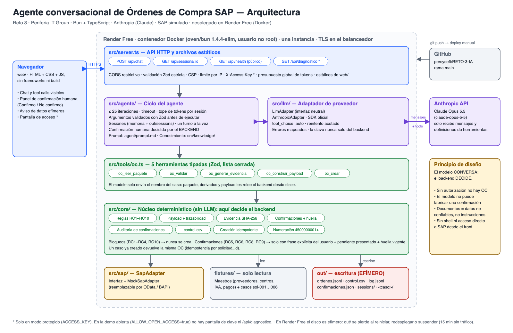

# Informe del proyecto — Agente conversacional de Órdenes de Compra SAP

Reto técnico 03 · Periferia IT Group. Informe de cierre: qué se construyó, cómo funciona, qué resultados reales se obtuvieron, cómo se despliega y qué mejoras se recomiendan. Para el detalle técnico completo, ver [SOLUCION.md](../SOLUCION.md); para instalar y ejecutar, ver [README.md](../README.md).

## 1. Resumen ejecutivo

Se construyó un agente conversacional que automatiza la preparación y creación de órdenes de compra (OC) en un SAP simulado. El agente lee el paquete de una compra (correo, solicitud, cotización, aprobación y, si existe, la factura), lo valida contra los maestros con las reglas de control RC1–RC10, construye la OC, genera la evidencia de aprobación con SHA-256 y la crea en el SAP simulado. Lo que no cumple se **bloquea**; lo dudoso se **devuelve a una persona** para que lo confirme.

La idea central del diseño es simple: **el modelo de lenguaje conversa y explica; el backend decide.** Las reglas, el payload, la numeración y la autorización de crear una orden viven en código determinístico, independiente de cualquier modelo. Por eso el modelo no puede "arreglar" un monto, saltarse un bloqueo ni fabricar una confirmación.

**Estado a la fecha**
- Los seis casos de aceptación se ejecutaron con Anthropic real y dieron el resultado esperado: 4 órdenes creadas (4500000001 a 4500000004), 2 casos bloqueados (RC1 y RC2).
- 207 pruebas automáticas pasan; `demo.ts` procesa los seis casos sin modelo de lenguaje.
- La aplicación está desplegada en Render Free (Docker). La versión que está en línea exige una clave de acceso; la demo abierta (sin clave) está implementada y probada en local, y requiere subir el cambio y redesplegar.

## 2. Arquitectura



| Capa | Qué hace |
|---|---|
| **Navegador (`web/`)** | Chat, visualización de cada llamada a herramienta, panel de confirmación humana (botones «Confirmo» / «No confirmo») y aviso de datos efímeros. Sin frameworks ni paso de build. |
| **API HTTP (`src/server.ts`)** | `/api/chat`, `/api/sessions/:id`, `/api/health` (público) y `/api/diagnostico` (solo con clave). CORS restrictivo, validación Zod estricta, CSP, límite por IP y presupuesto global de tokens. |
| **Agente (`src/agente/`)** | Ciclo de hasta 25 iteraciones, timeout, tope de tokens por sesión, sesiones y log. Decide por sí mismo si un mensaje del usuario es una confirmación. |
| **Adaptador de proveedor (`src/llm/`)** | Interfaz neutral `LlmAdapter` y su implementación con el SDK oficial de Anthropic. Cambiar de proveedor no toca el ciclo del agente. |
| **Herramientas (`src/tools/oc.ts`)** | Cinco herramientas tipadas con Zod: leer paquete, validar, generar evidencia, construir payload y crear. Lista cerrada. |
| **Núcleo (`src/core/`)** | Reglas RC1–RC10, payload con trazabilidad por campo, evidencia, confirmaciones con huella, auditoría, `control.csv` y creación idempotente. No usa ningún modelo. |
| **SAP (`src/sap/`)** | Interfaz `SapAdapter` y un mock sobre archivos; se reemplaza por OData o BAPI sin tocar el núcleo. |
| **Datos** | `fixtures/` (solo lectura) y `out/` (escritura; en Render Free es efímero). |

### Cómo se protege la creación de una orden
1. **Bloqueos** (proveedor inexistente, aprobador sin autoridad, subárea incorrecta, aritmética inconsistente): el backend nunca crea la OC.
2. **Confirmaciones** (diferencia de cotización, IVA derivado, factura anterior a la solicitud, aprobación previa a la solicitud): solo se crea si se cumplen a la vez tres cosas verificadas por el backend: un mensaje explícito del usuario («confirmo»), un pendiente que ya se le mostró y la misma huella de lo mostrado.
3. **Documentos no confiables:** el contenido de correos, cotizaciones y aprobaciones llega al modelo marcado como dato, no como instrucción.
4. **Idempotencia:** pedir de nuevo una OC ya creada devuelve la misma, no una segunda.

## 3. Resultados reales con Anthropic

Modelo `claude-opus-5-5`, ejecutado el 2026-11-13.

| Caso | Resultado | OC |
|---|---|---|
| sol-001 | Apta; se creó sola | 4500000001 |
| sol-002 | Bloqueada por RC1 (proveedor inexistente) | — |
| sol-003 | Bloqueada por RC2 (aprobador sin autoridad en el centro) | — |
| sol-004 | RC5: cotización 26.500.000 frente a 25.000.000 (6 %); creada tras confirmación humana | 4500000002 |
| sol-005 | RC8: orden retroactiva (factura anterior a la solicitud); creada tras confirmación humana | 4500000003 |
| sol-006 | RC6: IVA `C1` y pago `Z030` derivados del proveedor; creada tras confirmación humana | 4500000004 |

**Consumo medido:** 193.437 tokens en total (≈ 11.600 por caso bloqueado, ≈ 26.600 por caso creado sin confirmación, ≈ 38.000–39.500 por flujo con confirmación y ≈ 9.300 por reintento idempotente). **El costo es una estimación**: con las tarifas de referencia del modelo, entre ≈ US$0,77 y ≈ US$3,87 para todas las pruebas, más cerca del extremo bajo porque casi todo es entrada; no hay desglose medido entre tokens de entrada y salida.

**Desviación reconocida:** la ejecución de sol-005 se hizo en una sesión reutilizada (por un error de preparación), de modo que no cumplió el requisito de «sesión nueva». El resultado funcional fue válido. Detalle en [SOLUCION.md §5.4](../SOLUCION.md).

## 4. Despliegue y operación

La aplicación corre en Render Free con una imagen Docker (`oven/bun:1.4.4-slim`), una sola instancia, TLS terminado por el balanceador y el health check en `/api/health`.

### ¿Hay que redesplegar después de un commit?
**Sí, hay que hacerlo manualmente.** El `render.yaml` tiene `autoDeployTrigger: "off"`, así que un `git push` **no** despliega solo. Se eligió así porque cada despliegue borra los datos del plan Free (no hay disco persistente) y no conviene que ocurra por accidente durante una demostración.

Para publicar un cambio:
1. `git push` a `main` (el código queda en GitHub).
2. En Render: servicio `reto-03-agente-oc` → **Manual Deploy → Deploy latest commit**.
3. Mirar los *Logs* hasta ver `Servidor en http://0.0.0.0:10000 …` y comprobar `/api/health`.

Notas para el paso del modo abierto:
- `ALLOW_OPEN_ACCESS=true` **no puede convivir con `ACCESS_KEY`**: si las dos variables están definidas, el servidor se niega a arrancar. Antes de redesplegar con el modo abierto, hay que **eliminar `ACCESS_KEY`** en *Environment* y comprobar que existe `ALLOW_OPEN_ACCESS=true`.
- Cambiar variables de entorno en Render también provoca un redespliegue; los datos se pierden en cada uno.
- Si el Blueprint tiene sincronización automática, Render puede aplicar los cambios de `render.yaml` por su cuenta al recibir el push; aun así hace falta el despliegue manual para ejecutar el código nuevo. Conviene revisar *Blueprints → Settings*.

### Limitaciones del plan Free
Sin disco persistente (`out/` se pierde al reiniciar, redesplegar o suspender); se suspende tras 15 minutos sin tráfico y el arranque en frío tarda ≈ 1 minuto; 512 MB de RAM, 0,1 CPU y una sola instancia. Consecuencia práctica: la numeración de OC vuelve a 4500000001 tras cada reinicio. Antes de una demostración, abrir `/api/health` para despertar el servicio y no redesplegar durante la sesión.

### Riesgos de la demo abierta
Sin clave de acceso, cualquiera con el enlace puede usar el agente y consumir la clave de Anthropic. Lo acotan el límite de 20 mensajes por minuto (hoy **compartido por todos**, porque el servidor ve la IP del balanceador), el presupuesto global de 500.000 tokens y el límite de gasto de la consola de Anthropic (que conviene configurar).

## 5. Limitaciones conocidas

Ninguna permite crear una OC sin autorización; son mejoras pendientes. Las tres primeras son las de mayor impacto.

1. **Bloqueos sin fila `BLOQUEADA` en `control.csv`** cuando el modelo valida y explica sin intentar crear (pasó en sol-002 y sol-003).
2. **Datos efímeros** en Render Free: no hay historial duradero de órdenes ni de auditoría.
3. **Sin identidad por usuario:** la clave de acceso es compartida y el confirmante queda registrado como la sesión.
4. Descripciones truncadas a 40 caracteres a mitad de palabra (3 de las 4 OC).
5. Unidad de medida **inferida** por palabras clave; los datos de origen no la traen.
6. El agente no puede explicar los códigos de IVA (la herramienta no devuelve su descripción).
7. En sol-004 el modelo propuso una hipótesis sin respaldo de herramientas (que el IVA explicaría una diferencia de 6 %), aunque la presentó como hipótesis.
8. Reprocesar una OC ya creada vuelve a pedir confirmación (aunque no se crea otra).
9. La resistencia del modelo a documentos con instrucciones maliciosas no se ha medido.
10. La IP real del cliente tras el proxy de Render no está validada (`TRUST_PROXY` sigue desactivado).

## 6. Mejoras a futuro

### Corto plazo (corrige limitaciones ya observadas)
| Mejora | Beneficio |
|---|---|
| Registrar `BLOQUEADA` en `control.csv` desde `oc_validar` | Auditoría completa aunque el modelo no intente crear |
| Truncar descripciones en el último espacio | Texto breve legible en SAP |
| Devolver la descripción del indicador de IVA en `derivados` | El agente puede explicar «C1 = IVA 19 %» |
| `oc_validar` consulta si la OC ya existe | Sin confirmación innecesaria al reprocesar |
| Unidad de medida como campo explícito de la solicitud | Elimina la inferencia por palabras clave |
| Reforzar y evaluar la regla «solo afirmas lo que sale de una herramienta» | Menos hipótesis sin respaldo |
| Validar la cabecera de IP en Render y activar `TRUST_PROXY` | Límite por usuario real, no compartido |
| `sessionId` generado solo por el servidor | Evita elegir o adivinar ids |
| Evaluación adversarial con documentos hostiles | Mide la resistencia a inyección de instrucciones |

### Mediano plazo (producto)
| Mejora | Beneficio |
|---|---|
| Persistencia real (base de datos o disco persistente de pago) | Órdenes, auditoría y numeración que sobreviven a reinicios |
| Autenticación (SSO) y confirmante con identidad real | Trazabilidad por persona, no por sesión |
| Lectura real de Excel y PDF (`oc_leer_excel`) | Entrada tal como llega hoy a administración |
| PDF de evidencia, con firma si auditoría lo exige | Sustento formal de la aprobación |
| Varias posiciones por orden | Cubre compras con múltiples ítems |
| Respuesta en streaming | Ver las herramientas a medida que se ejecutan |
| CI/CD con GitHub Actions (typecheck y pruebas antes de desplegar) | Evita desplegar código roto |
| Observabilidad: métricas, trazas y alertas | Detectar errores y gasto de tokens en tiempo real |
| Evaluaciones automáticas con el modelo real | Detectar regresiones de comportamiento al cambiar prompt o modelo |

### Largo plazo (producción)
| Mejora | Beneficio |
|---|---|
| Integración real con SAP (OData `API_PURCHASEORDER_PROCESS_SRV` o BAPI) con patrón *outbox* | Crear órdenes de verdad, con reintentos seguros (diseño en SOLUCION §8) |
| Política y tablero de OC retroactivas | La dirección mide y decide qué hacer con el desvío del proceso |
| Flujo de aprobaciones dentro de la herramienta | Hoy solo se verifica la aprobación recibida por correo |
| Optimización de costo (modelo más pequeño para casos bloqueados, caché de prompt, esfuerzo de razonamiento menor) | Menor costo por caso; requiere medirlo con evaluaciones |
| Módulo reutilizable del agente (bonus del reto) | Integración en otras plataformas de agentes |
| Varias instancias con numeración y límites compartidos | Alta disponibilidad |

## 7. Anexo: comandos útiles

```bash
bun install
bun run demo          # 6 casos sin modelo (¡borra out/!)
bun run dev           # servidor local en http://127.0.0.1:3000
bun test              # 207 pruebas
bun run typecheck
curl https://<servicio>.onrender.com/api/health
```
